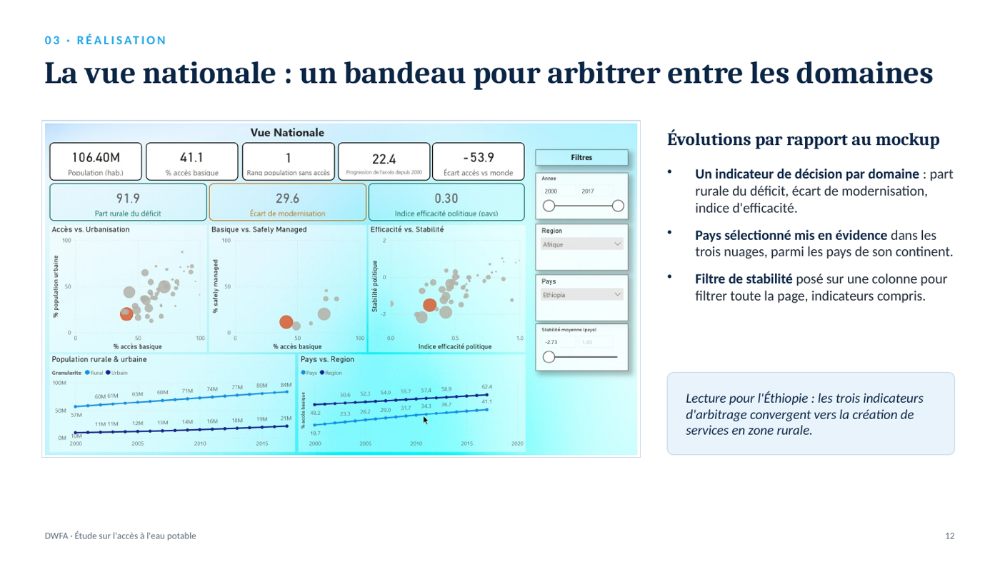

# Accès à l'eau potable — tableau de bord d'aide à la décision pour une ONG

> Où une ONG doit-elle investir un nouveau financement ? Un tableau de bord Power BI à trois niveaux (monde, continent, pays) qui oriente vers un pays et un domaine d'intervention. Exemple : l'Éthiopie, avec la création de services en zone rurale.



**Projet 10 · OpenClassrooms Data Analyst · septembre 2026** · Power BI · Power Query · DAX · Blueprint et mockup · Accessibilité

---

## Besoin métier
L'ONG *Drinking Water For All* sollicite un bailleur de fonds. Le financement sera investi dans **un seul de ses trois domaines**, dans un pays encore à déterminer :
- la création de services ;
- la modernisation vers des services « safely managed » ;
- le consulting auprès des gouvernements.

Le tableau de bord doit permettre de descendre du monde au pays et d'exclure les pays trop instables.

## Données
- **5 sources OMS / FAO**, 194 pays, 2000–2017 : accès basique et « safely managed » (total, rural, urbain), population, stabilité politique, mortalité liée à l'eau (2016 seulement), régions OMS.
- **6 anomalies corrigées ou documentées :**
  - Chine comptée deux fois ;
  - libellés de pays divergents ;
  - séparateur décimal mal interprété (point lu comme séparateur de milliers sur un poste configuré en français) ;
  - successions d'États sans population ;
  - couverture partielle du « safely managed » ;
  - mortalité disponible pour une seule année.

## Démarche
1. **Blueprint :** chaque besoin relié à une mesure, un visuel et une page. Il a servi de contrat avant toute construction.
2. **Mockup** validé avant le développement : bandeau d'indicateurs, graphiques au centre, filtres identiques sur les 3 pages.
3. **Préparation tracée dans Power Query :** chemin paramétré, typage forcé en culture en-US, table de correspondance des pays.
4. **Modèle en étoile**, avec une table déconnectée pour mettre en évidence le pays sélectionné.
5. **Choix de calcul :**
   - moyennes **pondérées par la population**, faute de quoi Malte pèserait autant que l'Inde ;
   - indicateurs de stock lus en fin de période ;
   - indice d'efficacité normalisé par continent.
6. **Accessibilité :** aucune information portée par la seule couleur, titres rédigés sous forme de messages, textes alternatifs. Modèle de 737 Ko.

## Résultats
| Indicateur | Valeur |
|---|---|
| Personnes sans accès basique (2017) | **778 M**, dont **49,7 %** en Afrique |
| Accès basique mondial | 80,5 % → **89,6 %** entre 2000 et 2017 (+9,1 pts) |
| Éthiopie | 62,7 M sans accès (3e pays au monde) ; **91,9 %** du déficit en zone rurale ; indice d'efficacité 0,30 |

**Recommandation pour l'Éthiopie :** les trois indicateurs d'arbitrage convergent vers la **création de services en milieu rural**. La faible stabilité du pays (−1,5) rend le consulting plus risqué.

## Limites et pistes
- Le « safely managed » ne couvre que 98 pays ; la mortalité n'est disponible que pour 2016.
- La stabilité est jugée sur la moyenne 2000–2017 et non année par année.
- **Pistes :** actualiser avec les données JMP postérieures à 2017, ajouter le coût d'intervention par habitant et les financements déjà engagés par d'autres acteurs.

## Compétences mobilisées
`Power BI` · `Power Query` · `DAX` · `Modèle en étoile` · `Blueprint` · `Mockup` · `Accessibilité` · `Aide à la décision`

## Contenu
```
livrables/
  Cabart_Leo_2_dashboard_092026.pbix         # tableau de bord (Power BI Desktop)
  Cabart_Leo_1_presentation_092026.pdf       # présentation
  blueprint.pdf
data/                                        # 5 fichiers sources OMS/FAO et dictionnaire
images/mockup.jpg
```

---
Leo Cabart · Data Analyst · [Portfolio](https://lcabart21.github.io) · [GitHub](https://github.com/lcabart21)
